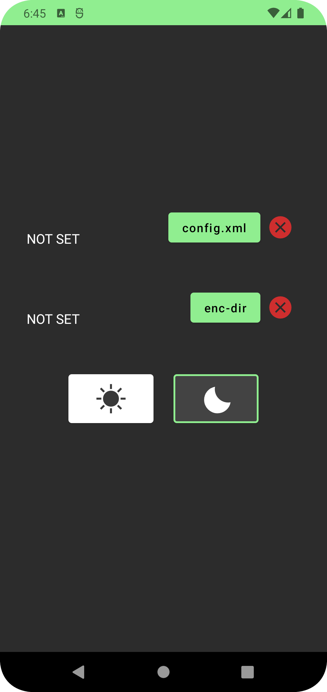
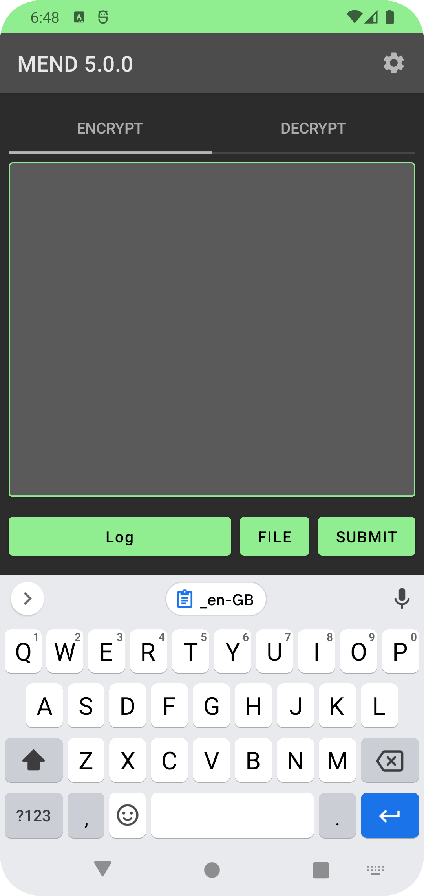
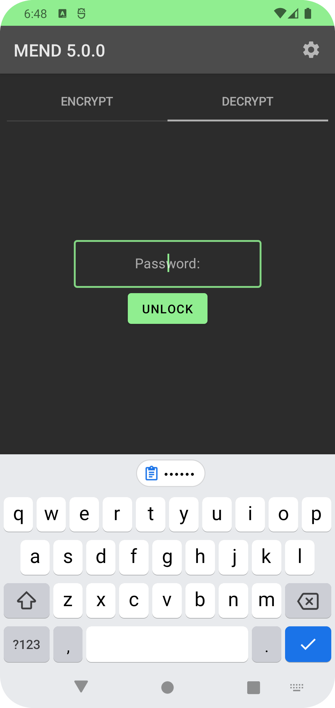
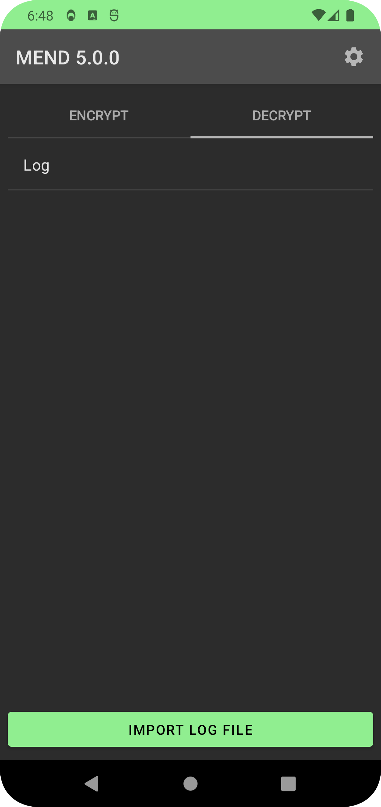
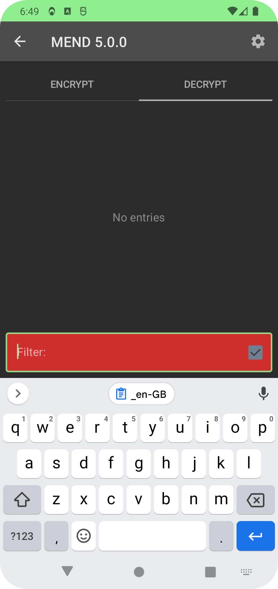
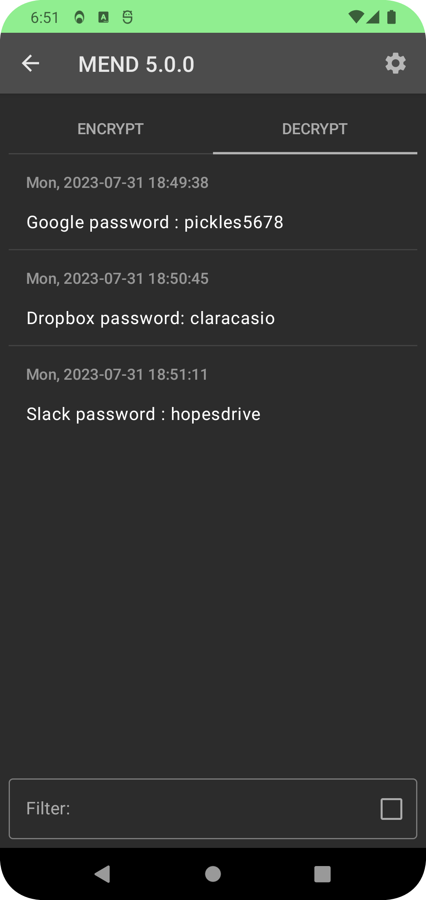
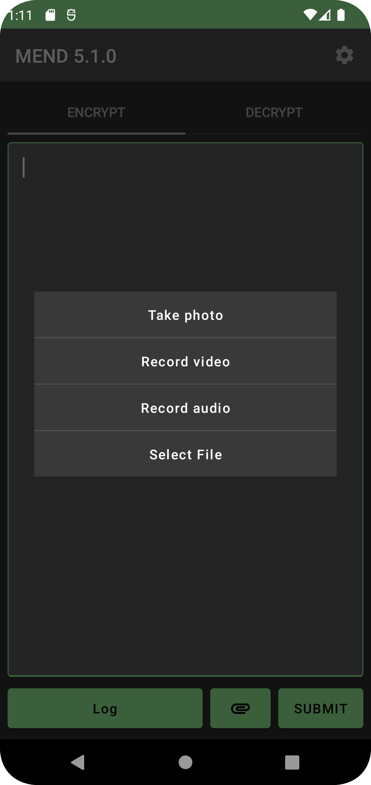

# MEND Android
You will need to read [the project README](../README.md) and have created a `config.xml` file using the setup process described in the [commandline application README](../desktop-mend/README.md) to use this app. You can build the app yourself or get the apk from the [releases page](https://github.com/SamAmco/MEND4/releases)

## Building a signed release APK

The app targets Android 17 (API 37) and supports Android 12 (API 31) and newer.
Use JDK 25 and install Android SDK Platform 37 through Android Studio's SDK Manager.
Set `sdk.dir` in the root `local.properties` to your Android SDK directory if it is
not already configured. Use the included Gradle wrapper for the commands below.

The `release` variant uses package name `co.samco.mendroid`, is not debuggable,
and is signed using your own keystore. The current version is **5.7.0**
(`versionCode` **50700**). Cloud backups are disabled, and the extraction rules
exclude all app data from both cloud backups and device transfers.

1. Keep your JKS file outside the repository. Find its key alias if needed:

   ```sh
   keytool -list -keystore /absolute/path/to/your-key.jks
   ```

2. Add these entries to the existing root `local.properties`, preserving `sdk.dir`
   and any other settings:

   ```properties
   MENDROID_STORE_FILE=/absolute/path/to/your-key.jks
   MENDROID_STORE_PASSWORD=your-keystore-password
   MENDROID_KEY_ALIAS=your-key-alias
   MENDROID_KEY_PASSWORD=your-key-password
   ```

   The key password may be the same as the keystore password. This file is ignored
   by version control; restrict access with `chmod 600 local.properties`.
   Values use Java properties syntax, so backslashes must be escaped.
   Alternatively, supply the same names as environment variables or Gradle
   properties (for example in `~/.gradle/gradle.properties`). Gradle properties
   take precedence over environment variables, then `local.properties`.

3. From the repository root, build and check the release:

   ```sh
   ./gradlew :mendroid:assembleRelease :mendroid:lintRelease :mendroid:testReleaseUnitTest
   ```

   The signed APK is written to:

   ```text
   mendroid/build/outputs/apk/release/mendroid-release.apk
   ```

   All four signing settings must be provided to produce a signed release.
   Without them, Gradle produces an unsigned APK (`mendroid-release-unsigned.apk`).
   To produce a signed Android App Bundle instead, run `./gradlew :mendroid:bundleRelease`.

4. Install the APK over ADB:

   ```sh
   adb install -r mendroid/build/outputs/apk/release/mendroid-release.apk
   ```

The normal debug build uses `co.samco.mendroid.debug`, so release installs alongside
it with separate app data. Import your `config.xml` and select your encrypted-data
folder and log directory in the release app. Keep the debug app until you have
checked decryption in the release app. Update your existing debug installation too, or remove it after
migrating, so its installed copy also stops participating in backups. Updating an
existing installation of `co.samco.mendroid` requires
the same signing key as that installation; keep using and securely retain your JKS.

In the unlocked notification, tap the body to open MEND, or use the **Lock MEND**
action to lock immediately.

Before relying on a new build, check unlocking, log encryption/decryption, opening
decrypted attachments, photo/video capture, audio recording/playback, notification
lock actions, and system back navigation on your device. Build and lint checks do
not exercise those device interactions.

## Development checks

```sh
./gradlew :mendroid:assembleDebug :mendroid:lintDebug :mendroid:testDebugUnitTest --warning-mode all
```

Kotlin and lint warnings fail the Android build. The app uses Material 3 throughout,
with no lint suppressions or dependency downgrades for the migration.

KSP 2.3.12 currently emits a Gradle 9.8 deprecation warning for its internal use of
`Configuration.setVisible`. This comes from the latest KSP plugin, rather than app code.
 
<p align="center">
	
	
	
	
	
	
	
</p>

## Local log directory

Select **log-dir** in Settings using a folder in device storage or on an SD card.
Both Encrypt and Decrypt list the `.mend` files directly inside that folder.
Encrypt remembers the selected log; **Create** asks for a name and creates the log
inside log-dir, adding `.mend` if needed. Existing names are rejected rather than
overwritten. Decrypt no longer imports individual log files.

Use a file manager to add, remove, rename, or move logs. Lists refresh when you
return to the screen. If the selected log is removed, choose another before
writing; MEND does not automatically recreate it. Changing log-dir clears the
selection. Cloud document-provider folders cannot be selected for log-dir; use
the separate Nextcloud settings to back up logs after local writes.

## Automatic Nextcloud backups

Nextcloud uploads are optional and keep your existing local storage arrangement.
Select an **enc folder on your device** and a **local log directory** in Settings.
Then open Nextcloud uploads from Settings or the status button above the main tabs:

1. Enter your Nextcloud HTTPS server address (including its subdirectory, if any).
2. Tap **Connect to Nextcloud**, sign in in your browser, and grant MEND access.
3. Select an existing remote folder for attachments and another for logs. The root
   folder is also selectable. MEND does not need the Nextcloud Android app.
4. New successful attachment and log writes are queued automatically. To include
   older files, tap **Back up existing local files** after selecting both folders.

Uploads continue while MEND is locked. By default they wait for an unmetered
connection; enable metered connections if you want to use mobile data. Android
may delay background work, particularly after force-stopping the app or under
battery restrictions. Reopen MEND after force-stopping it to resume scheduling.
The status button opens individual upload states, progress and errors, with
**Retry**, **Pause uploads**, and **Disconnect** controls. **Remove from upload
list** clears a completed/failed queue entry without deleting local or remote
files. Removing an entry does not prevent a future MEND write from queuing it again.

The phone is authoritative for `.mend` logs: each upload replaces the whole remote
log backup. Give this phone its own log filenames; changes made to the remote log
by another machine will be overwritten. Multiple local writes coalesce and all
transfers run serially. Attachments preserve their existing `.enc` filenames;
an existing remote attachment is accepted only if its encrypted content matches.
Two different local URIs targeting one remote name require attention.

Local files remain user-managed. Deleting a local file never deletes its remote
backup, but removing or moving a pending file may prevent its upload. Configure
additional Nextcloud folders below to open remotely stored logs and attachments.
MEND does not watch for edits made by other apps.
An in-progress upload holds a temporary encrypted snapshot, so it can finish even
if you delete the local original after that snapshot was taken.

If a local save succeeds but the queue cannot record it, MEND shows a persistent
attention warning. After checking the local files, use **Back up existing local
files** to register them and clear that warning.

Pending jobs remember their original account and remote path. Changing remote
folder selections affects future writes, and reconnecting the original account
allows its pending jobs to resume. A failed/interrupted local write is never
uploaded automatically: check the local file and explicitly queue its backup, or write it again.
Ordinary Retry and reconnect never enable failed/interrupted local writes. After
checking a file, use its **Back up checked local file** action to explicitly queue
it again; this retains the original destination. New successful writes also clear
the local-write failure for their revision.

No plaintext, private encryption key, or `config.xml` is uploaded. The Nextcloud
app password is encrypted using Android Keystore and excluded from Android backup.

Transfers use WebDAV PUT followed by MOVE from a temporary encrypted sibling.
They currently restart a failed transfer rather than resuming chunks, so the
server/proxy must allow a request as large as the encrypted file. Oversized files,
full storage, access denial, and destination conflicts appear as errors. A failed
connection can leave a `.mend-upload-*` encrypted temporary file on the server;
it is safe to remove those when MEND is not uploading. MEND retains local files
after successful uploads and does not propagate deletions.

## Reading additional Nextcloud folders

Open **Nextcloud files and uploads** and add folders under **Additional Nextcloud
folders**. These use the connected Nextcloud account and are read-only sources,
independent of the two upload destinations. Only files directly in each selected
folder are included; subfolders are not searched. Removing a source does not
delete any files.

While MEND is unlocked, the Decrypt tab lists local logs alongside `.mend` files
from these folders. Remote entries show their Nextcloud path. Use Refresh to pick
up changes. An unavailable folder shows an error while local logs and other
available folders remain usable. Opening a remote log downloads a fresh encrypted
copy before decrypting it.

Attachment references check the local enc folder first, then the additional
folders for the matching `.enc` filename. A remote match is downloaded on demand.
Downloads are encrypted temporary files in the app cache, cleared whenever MEND
locks and at app startup. Screen-off clears them when screen-off locking is
enabled. They are not an offline library and are never queued for upload.
